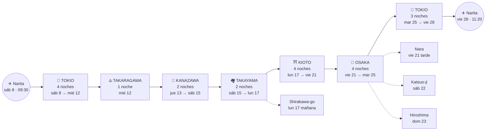
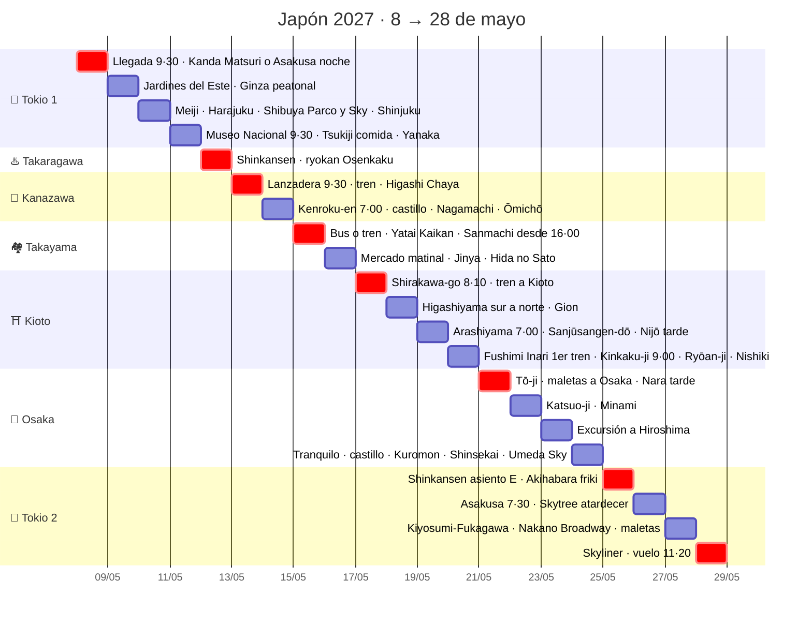

# Itinerario Japón 2027 · vista visual

> Plan vigente a 12 nov 2026. Fuente de detalle y justificaciones: [revision-itinerario-fechas-2027.md](revision-itinerario-fechas-2027.md).
> Vuelos: **vie 7 may** BCN 10:15 → **sáb 8 may** NRT 09:30 · **vie 28 may** NRT 11:20 → BCN 23:05.

---

## 1. La ruta: ciudades base, noches y excursiones

Las flechas continuas son cambios de hotel (con maletas y taxi). Las discontinuas son excursiones de ida y vuelta, sin maletas.

**Reparto de noches (20):** Tokio 4 · Takaragawa 1 · Kanazawa 2 · Takayama 2 · Kioto 4 · Osaka 4 · Tokio 3.

---

## 2. Calendario por semanas

| Semana | Lun | Mar | Mié | Jue | Vie | **Sáb** | **Dom** |
|---|---|---|---|---|---|---|---|
| **0** | | | | | ✈️ Salida BCN | 🗼 Llegada · Kanda / Asakusa noche | 🗼 Palacio · Ginza peatonal |
| **1** | 🗼 Meiji · Harajuku · Shibuya (Parco friki + Sky) · Shinjuku noche | 🗼 Museo Nacional · Tsukiji (comida) · Yanaka | ♨️ Onsen Takaragawa | 🏯 Llegada Kanazawa · Higashi Chaya | 🏯 Kenroku-en · Nagamachi · Ōmichō · tarde libre | 🏘️ Llegada Takayama · Yatai Kaikan · Sanmachi | 🏘️ Mercado · Jinya · Hida no Sato |
| **2** | 🏘️→⛩️ Shirakawa-go · tren a Kioto | ⛩️ Higashiyama sur→norte · Gion | ⛩️ Arashiyama · Sanjūsangen-dō · Nijō | ⛩️ Fushimi Inari al amanecer · Kinkaku-ji · Nishiki | ⛩️→🍜 Tō-ji (mercadillo) · maletas a Osaka · Nara tarde | 🍜 Katsuo-ji · Minami | 🍜 Hiroshima |
| **3** | 🍜 Día tranquilo · castillo de Osaka · Kuromon · Shinsekai · Umeda Sky atardecer | 🍜→🗼 Shinkansen · Akihabara friki | 🗼 Asakusa · Skytree | 🗼 Fukagawa · Nakano Broadway · maletas | ✈️ NRT 11:20 → BCN 23:05 | 🏠 Descanso | 🏠 Descanso |

---

## 3. Cronograma día a día

Cada fila es un día. Los días de cambio de hotel están marcados en rojo (`crit`).

---

## 4. Por qué cada cosa va en ese día

Hay cuatro reglas, por orden de prioridad:

| Regla | Días | Motivo |
|---|---|---|
| 🟥 **Mandan los cierres y las fechas fijas** | Mar 11 · Dom 9 · Vie 21 | El Museo Nacional de Tokio cierra los lunes. Los Jardines del Este cierran lunes y viernes. Tsukiji cierra los domingos. El mercadillo de Tō-ji solo se celebra el día 21 |
| 🟩 **Laborable** para huir del turismo local | Mié 12 onsen · Lun 17 Shirakawa-go · Lun 10 Harajuku | Entre semana hay menos bañistas de día y la noche es más barata. Shirakawa-go se colapsa en domingo. Harajuku es intransitable en fin de semana |
| 🟨 **Laborable + hora extrema** para esquivar a los escolares de mayo (10–15 h) | Kioto, Nara y donde haga falta | **Primera oleada:** Fushimi Inari con el primer tren, Kiyomizu a las 6:00, Arashiyama a las 7:00, Kinkaku-ji a las 9:00 en punto, Kenroku-en a las 7:00, Asakusa a las 7:30. Tōdai-ji, a la inversa, a última hora de la tarde |
| 🟦 **Fin de semana** donde se gana algo o no se pierde nada | Dom 9 Ginza · Sáb 22 Katsuo-ji · Dom 23 Hiroshima · Sáb 15 / Dom 16 Takayama | Ginza solo es peatonal en fin de semana. Katsuo-ji tiene más autobuses. En Hiroshima no hay grupos escolares en domingo. Takayama es una ciudad que absorbe a la gente |

---

## 5. Los días de traslado de cerca

| Día | Trayecto | Cómo | Llegada aprox. |
|---|---|---|---|
| Sáb 8 | Narita → Tokio | Skyliner (~41 min a Ueno) + taxi | ~12:30 |
| Mié 12 | Tokio → Takaragawa | Jōetsu Shinkansen (~1h15) + lanzadera del ryokan a las 13:00 o 15:00 (**reservar por teléfono**) | 13:45 o 15:45 |
| Jue 13 | Takaragawa → Kanazawa | Lanzadera 9:30 (la única) → Jōmō-Kōgen → Takasaki → Hokuriku Shinkansen | ~14:00 |
| Sáb 15 | Kanazawa → Takayama | Bus Nōhi con reserva (~2h15) o tren por Toyama (solo 4 trenes Hida al día) | mediodía |
| Lun 17 | Takayama → Kioto | Shirakawa-go por la mañana, vuelta a Takayama → Hida a Nagoya + Shinkansen | ~17:00 |
| Vie 21 | Kioto → Osaka | Tō-ji (las maletas se quedan en el hotel) → recogerlas → JR a Osaka + taxi a Namba → **dejarlas en el hotel** → Nara en ida y vuelta por la tarde | ~12:30 |
| Mar 25 | Osaka → Tokio | Tōkaidō Shinkansen, **asiento E** para ver el Fuji | ~mediodía |
| Vie 28 | Tokio → Narita | Taxi → Skyliner desde Ueno/Nippori → T1 | ~8:45 |

**Pendiente de confirmar más adelante:**
- Las fechas del Kanda Matsuri, que se publican en primavera de 2027.
- Los horarios de trenes y autobuses de 2027, después del cambio de marzo.
- Los horarios de Ginkaku-ji y Nanzen-ji.
